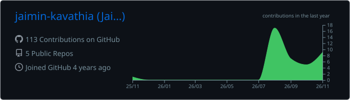
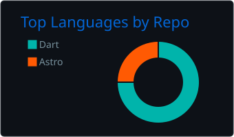
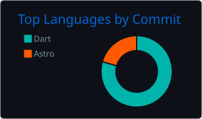

<div align="center">

<a href="https://jaimin-kavathia.github.io/"></a>

<p></p>

<a href="https://jaimin-kavathia.github.io/"></a>&nbsp;
<a href="https://play.google.com/store/apps/developer?id=Jaimin+Kavathia"></a>&nbsp;
<a href="https://medium.com/@jaiminkavathia30"></a>&nbsp;
<a href="https://www.linkedin.com/in/jaimin-kavathia-flutter-developer/"></a>

</div>

<br/>

I'm a senior Flutter developer based in Ahmedabad, India. For 5+ years and across 30+ delivered projects, I've been building fast, dependable apps for Android, iOS, web and desktop: real-time social feeds, live sports, connected devices and health products, all from one Flutter codebase that stays clean enough to grow.

When the ecosystem is missing a piece, I write it and open-source it. And when the idea is my own, I take it all the way to Google Play.

## Open source on pub.dev

**Two packages, built for the problems every Flutter app runs into.** Permissions and media picking are in almost every app, and almost always painful. I packaged the way I solve them, so nobody has to write that code twice.

### [smart_permission](https://pub.dev/packages/smart_permission)

**Runtime permissions, handled in one line.**

[](https://pub.dev/packages/smart_permission)
[](https://pub.dev/packages/smart_permission/score)
[](https://pub.dev/packages/smart_permission/score)
[](https://pub.dev/packages/smart_permission/score)
[](https://github.com/jaimin-kavathia/smart_permission)
[](https://github.com/jaimin-kavathia/smart_permission/blob/main/LICENSE)

Ask for a permission with a single call and let the package run the whole flow: rationale, the native prompt, denied and permanently-denied states, and the trip to Settings and back.

```dart
final granted = await SmartPermission.request(
  context,
  permission: Permission.camera,
);
```

- One call for a single permission, or a batch of them
- Complete flows for denied, permanently denied and restricted states
- Adaptive Material and Cupertino dialogs, themeable and localised
- `PermissionGate` widget, analytics hooks and a fake gateway for tests

`Android` `iOS` `Web` `Windows`

```sh
flutter pub add smart_permission
```

[pub.dev](https://pub.dev/packages/smart_permission) · [Guide](https://jaimin-kavathia.github.io/packages/smart-permission/) · [Source](https://github.com/jaimin-kavathia/smart_permission) · [Read the story](https://medium.com/@jaiminkavathia30/introducing-smart-permission-runtime-permissions-made-effortless-in-flutter-30f4785a588f)

### [adaptive_media_picker](https://pub.dev/packages/adaptive_media_picker)

**Media picking that just works, everywhere.**

[](https://pub.dev/packages/adaptive_media_picker)
[](https://pub.dev/packages/adaptive_media_picker/score)
[](https://pub.dev/packages/adaptive_media_picker/score)
[](https://pub.dev/packages/adaptive_media_picker/score)
[](https://github.com/jaimin-kavathia/adaptive_media_picker)
[](https://github.com/jaimin-kavathia/adaptive_media_picker/blob/main/LICENSE)

An image and video picker with the hard parts built in: permissions, a camera or gallery sheet, cropping and validation. On Android it uses the system photo picker, so your app never declares a media permission.

```dart
final picker = AdaptiveMediaPicker();
final result = await picker.pickImage(context: context);
```

- Images, videos or both, single or multiple with a hard limit
- Built-in permission handling, including iOS limited photo access
- Cropping with ratio presets, plus circle crop for avatars
- Typed results instead of exceptions, with size and type validation

`Android` `iOS` `Web` `macOS` `Windows` `Linux`

```sh
flutter pub add adaptive_media_picker
```

[pub.dev](https://pub.dev/packages/adaptive_media_picker) · [Guide](https://jaimin-kavathia.github.io/packages/adaptive-media-picker/) · [Source](https://github.com/jaimin-kavathia/adaptive_media_picker) · [Read the story](https://medium.com/@jaiminkavathia30/flutters-missing-piece-effortless-media-picking-with-limited-access-support-9a1a24404667)

## Live on Google Play

**Apps I designed, built and shipped on my own.** Idea, design, code, release and support. These are mine from the first commit to the store listing.

<a href="https://play.google.com/store/apps/developer?id=Jaimin+Kavathia"></a>

<table>
  <tr>
    <td width="96" align="center" valign="top">
      <br/>
      <a href="https://play.google.com/store/apps/details?id=com.toolverse.fotaro"></a>
    </td>
    <td valign="top">
      <h3>Fotaro</h3>
      <sub>AI PHOTO &amp; VIDEO EDITOR · PHOTOGRAPHY · NOV 2026 · LATEST RELEASE</sub>
      <p><b>Edit photos and videos like film.</b> A photo, video and audio editor and a cinema camera in one app. Sharpen a photo in one tap, choose from 130 film looks, remove backgrounds, build collages and carousels, and cut videos on a timeline. It all runs on the phone, with no account and no watermark.</p>
      <p><code>130 film looks</code> <code>Dual camera</code> <code>No watermark</code></p>
      <p><a href="https://play.google.com/store/apps/details?id=com.toolverse.fotaro"><b>Get it on Google Play</b></a> · <a href="https://jaimin-kavathia.github.io/apps/fotaro/">About Fotaro</a></p>
    </td>
  </tr>
  <tr>
    <td width="96" align="center" valign="top">
      <br/>
      <a href="https://play.google.com/store/apps/details?id=com.toolverse.parking"></a>
    </td>
    <td valign="top">
      <h3>SpotBuddy</h3>
      <sub>FIND MY PARKED CAR · MAPS &amp; NAVIGATION · NOV 2026</sub>
      <p><b>Never forget where you parked.</b> Save your parking spot in one tap, then walk back to it with directions, a compass arrow and live distance, even underground where GPS gets lost. A meter timer warns you before your ticket runs out.</p>
      <p><code>One-tap save</code> <code>Meter timer</code> <code>Home-screen widgets</code></p>
      <p><a href="https://play.google.com/store/apps/details?id=com.toolverse.parking"><b>Get it on Google Play</b></a> · <a href="https://jaimin-kavathia.github.io/apps/spotbuddy/">About SpotBuddy</a></p>
    </td>
  </tr>
  <tr>
    <td width="96" align="center" valign="top">
      <br/>
      <a href="https://play.google.com/store/apps/details?id=com.toolverse.arrowescape"></a>
    </td>
    <td valign="top">
      <h3>Arrow Escape</h3>
      <sub>TAP AWAY PUZZLE · PUZZLE GAME · OCT 2026</sub>
      <p><b>Tap the arrows away. Clear the board.</b> A tap-away logic puzzle where every arrow wants off the board, but only if nothing blocks its way. 10,000 levels across 100 worlds, nine themes and a daily challenge, all playable offline.</p>
      <p><code>10,000 levels</code> <code>9 themes</code> <code>Plays offline</code></p>
      <p><a href="https://play.google.com/store/apps/details?id=com.toolverse.arrowescape"><b>Get it on Google Play</b></a> · <a href="https://jaimin-kavathia.github.io/apps/arrow-escape/">About Arrow Escape</a></p>
    </td>
  </tr>
  <tr>
    <td width="96" align="center" valign="top">
      <br/>
      <a href="https://play.google.com/store/apps/details?id=com.toolverse.pdftools.app"></a>
    </td>
    <td valign="top">
      <h3>PDF Tools</h3>
      <sub>PDF EDITOR &amp; SCAN · PRODUCTIVITY · MAY 2026</sub>
      <p><b>Edit any PDF on your phone.</b> A PDF editor, document scanner and converter in one app. Edit text, fill and sign forms, scan paper with OCR, and merge, split or compress files. Documents are processed on the phone and never uploaded.</p>
      <p><code>Works offline</code> <code>Scan with OCR</code> <code>Fill and sign</code></p>
      <p><a href="https://play.google.com/store/apps/details?id=com.toolverse.pdftools.app"><b>Get it on Google Play</b></a> · <a href="https://jaimin-kavathia.github.io/apps/pdf-tools/">About PDF Tools</a></p>
    </td>
  </tr>
</table>

## Expertise

**What I bring to a product, end to end.**


<table>
  <tr>
    <td width="32%" valign="top"><b>One codebase, five platforms</b></td>
    <td valign="top">Android, iOS, web, macOS and Windows from a single Flutter codebase, with layouts and behaviour that respect each platform.</td>
  </tr>
  <tr>
    <td valign="top"><b>Architecture that stays readable</b></td>
    <td valign="top">Predictable state and clear boundaries, so features are easy to add and easy to test.<br/><code>BLoC</code> <code>Cubit</code> <code>Clean Architecture</code> <code>GetX</code> <code>Provider</code> <code>MVC</code></td>
  </tr>
  <tr>
    <td valign="top"><b>Real-time experiences</b></td>
    <td valign="top">Live scores, chat and presence that stay in sync over sockets.<br/><code>Socket.io</code> <code>Live scores</code> <code>Chat</code></td>
  </tr>
  <tr>
    <td valign="top"><b>IoT and connected devices</b></td>
    <td valign="top">Apps that talk to hardware: scanning, pairing, and controlling devices nearby or across the cloud.<br/><code>Bluetooth LE</code> <code>MQTT</code> <code>NFC</code> <code>AWS IoT</code></td>
  </tr>
  <tr>
    <td valign="top"><b>Native when it matters</b></td>
    <td valign="top">Platform channels into Kotlin and Swift for the things Flutter does not reach on its own.<br/><code>Dart</code> <code>Kotlin</code> <code>Swift</code></td>
  </tr>
  <tr>
    <td valign="top"><b>Monetisation and analytics</b></td>
    <td valign="top">Subscriptions, payments and the measurement to know what is working.<br/><code>In-App Purchases</code> <code>RevenueCat</code> <code>Mixpanel</code> <code>Google Analytics</code> <code>UXCam</code></td>
  </tr>
  <tr>
    <td valign="top"><b>Backend and cloud</b></td>
    <td valign="top">Auth, data, storage and messaging wired up cleanly, online and offline.<br/><code>Firebase</code> <code>REST APIs</code> <code>Push Notifications</code> <code>Google Maps</code> <code>SQLite</code> <code>Hive</code></td>
  </tr>
</table>

<details>
<summary><b>Full toolbox</b></summary>
<br/>
<table>
  <tr><td><b>Languages</b></td><td>Dart · Kotlin · Swift</td></tr>
  <tr><td><b>Framework</b></td><td>Flutter · Flutter Web · Flutter Desktop · FlutterFlow</td></tr>
  <tr><td><b>State</b></td><td>BLoC · Cubit · GetX · Provider</td></tr>
  <tr><td><b>Data</b></td><td>REST APIs · Firebase · Socket.io · MQTT · SQLite · Hive</td></tr>
  <tr><td><b>Device</b></td><td>Bluetooth LE · NFC · Biometrics · Camera · Maps · Background audio</td></tr>
  <tr><td><b>Growth</b></td><td>RevenueCat · In-App Purchases · Mixpanel · Google Analytics · Segment</td></tr>
  <tr><td><b>Tooling</b></td><td>Android Studio · Xcode · Git · Jira</td></tr>
</table>
</details>

## Journey

**5 years in, and still shipping.** From a first Flutter role in 2021 to five teams, two open-source packages and four apps of my own.

<details>
<summary><b>See the timeline</b></summary>
<br/>
<table>
  <tr>
    <td width="108" valign="top"><b>2026</b><br/><sub>RELEASE</sub></td>
    <td valign="top"><b>Four apps of my own</b> · Google Play<br/>PDF Tools in May, Arrow Escape in October, then SpotBuddy and Fotaro in November. Designed, built and published independently.</td>
  </tr>
  <tr>
    <td valign="top"><b>Oct 2025</b><br/><sub>RELEASE</sub></td>
    <td valign="top"><b>Published smart_permission</b> · pub.dev<br/>Second package: runtime permissions as a single call, with the full denied and settings flow handled.</td>
  </tr>
  <tr>
    <td valign="top"><b>Sep 2025</b><br/><sub>RELEASE</sub></td>
    <td valign="top"><b>Published adaptive_media_picker</b> · pub.dev<br/>First open-source package: media picking with permissions and limited-access support built in.</td>
  </tr>
  <tr>
    <td valign="top"><b>Aug 2025</b><br/><sub>CAREER</sub></td>
    <td valign="top"><b>Flutter Developer</b> · LogicRays Technologies<br/>Where I work today, building cross-platform apps with Flutter.</td>
  </tr>
  <tr>
    <td valign="top"><b>May 2024</b><br/><sub>CAREER</sub></td>
    <td valign="top"><b>Software Engineer</b> · Impero IT Services<br/>Led design and development of production apps, drove architecture upgrades for stability, and owned releases on the App Store and Google Play.<br/><sub>SYNERGIC TEAM AWARD, 2025</sub></td>
  </tr>
  <tr>
    <td valign="top"><b>Jun 2023</b><br/><sub>CERTIFICATE</sub></td>
    <td valign="top"><b>Flutter Development Bootcamp with Dart</b> · Udemy<br/>Completed the full bootcamp certification.</td>
  </tr>
  <tr>
    <td valign="top"><b>May 2023</b><br/><sub>CAREER</sub></td>
    <td valign="top"><b>Software Developer</b> · Plutus Technologies<br/>Agile delivery of mobile, desktop and web apps. Modernised legacy codebases, handled estimates and mentored junior developers.</td>
  </tr>
  <tr>
    <td valign="top"><b>Jan 2022</b><br/><sub>CAREER</sub></td>
    <td valign="top"><b>Flutter Developer</b> · Bluepixel Technologies<br/>Cross-platform apps and IoT products, including home automation, with regular code reviews to keep the quality bar high.<br/><sub>BEST TEAM AWARD, 2022</sub></td>
  </tr>
  <tr>
    <td valign="top"><b>Sep 2021</b><br/><sub>CAREER</sub></td>
    <td valign="top"><b>Flutter Developer</b> · Digimonk Solutions<br/>First professional Flutter apps, built closely with clients, with real-time communication and authentication integrations.</td>
  </tr>
  <tr>
    <td valign="top"><b>2017 – 2021</b><br/><sub>EDUCATION</sub></td>
    <td valign="top"><b>BE in Computer Engineering</b> · SVBIT, Gujarat<br/>Bachelor of Engineering at Shankersinh Vaghela Bapu Institute of Technology.</td>
  </tr>
</table>
</details>

## Writing

Notes on Flutter, my packages and the apps I ship, on [Medium](https://medium.com/@jaiminkavathia30).

<ul>
<!-- BLOG-POST-LIST:START --><li><a href="https://medium.com/@jaiminkavathia30/no-gps-underground-how-a-step-and-compass-trail-leads-you-back-ef7524fbf7e4">No GPS Underground? How a Step-and-Compass Trail Leads You Back</a> <sub>Nov 17, 2026</sub></li>
<li><a href="https://medium.com/@jaiminkavathia30/finding-your-car-in-a-multi-storey-car-park-floors-zones-and-photos-5b69b9c7b0ad">Finding Your Car in a Multi-Storey Car Park: Floors, Zones and Photos</a> <sub>Nov 13, 2026</sub></li>
<li><a href="https://medium.com/@jaiminkavathia30/make-a-wi-fi-qr-code-so-guests-join-without-typing-the-password-453812c58a89">Make a Wi-Fi QR Code So Guests Join Without Typing the Password</a> <sub>Nov 12, 2026</sub></li>
<li><a href="https://medium.com/@jaiminkavathia30/pull-every-date-amount-and-phone-number-out-of-a-pdf-d133ea16c8eb">Pull Every Date, Amount and Phone Number Out of a PDF</a> <sub>Nov 12, 2026</sub></li>
<li><a href="https://medium.com/@jaiminkavathia30/how-to-never-forget-where-you-parked-again-381373c42b02">How to Never Forget Where You Parked Again</a> <sub>Nov 12, 2026</sub></li>
<!-- BLOG-POST-LIST:END -->
</ul>

## GitHub activity

<div align="center">

<picture>
  <source media="(prefers-color-scheme: dark)" srcset="profile-summary-card-output/github_dark/0-profile-details.svg" />
  <source media="(prefers-color-scheme: light)" srcset="profile-summary-card-output/github/0-profile-details.svg" />
  
</picture>

<picture>
  <source media="(prefers-color-scheme: dark)" srcset="profile-summary-card-output/github_dark/1-repos-per-language.svg" />
  <source media="(prefers-color-scheme: light)" srcset="profile-summary-card-output/github/1-repos-per-language.svg" />
  
</picture>
<picture>
  <source media="(prefers-color-scheme: dark)" srcset="profile-summary-card-output/github_dark/2-most-commit-language.svg" />
  <source media="(prefers-color-scheme: light)" srcset="profile-summary-card-output/github/2-most-commit-language.svg" />
  
</picture>

<picture>
  <source media="(prefers-color-scheme: dark)" srcset="https://raw.githubusercontent.com/jaimin-kavathia/jaimin-kavathia/output/github-snake-dark.svg" />
  <source media="(prefers-color-scheme: light)" srcset="https://raw.githubusercontent.com/jaimin-kavathia/jaimin-kavathia/output/github-snake.svg" />
  
</picture>

</div>
